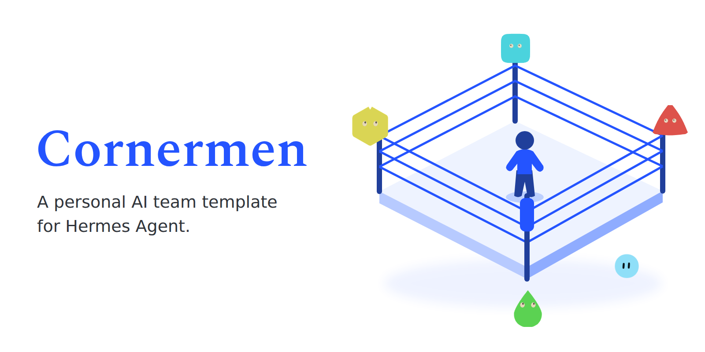
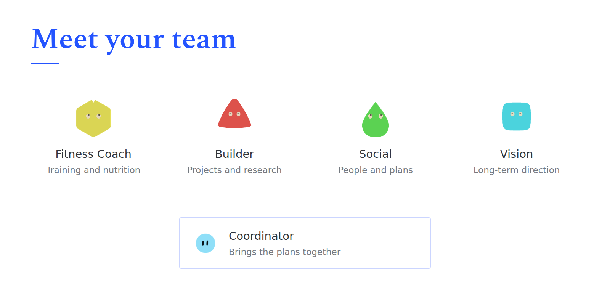
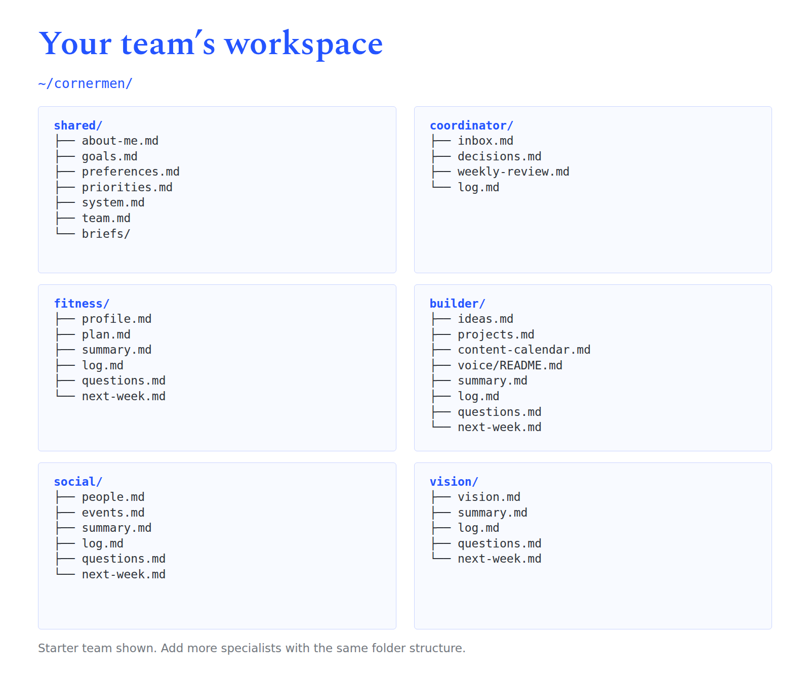
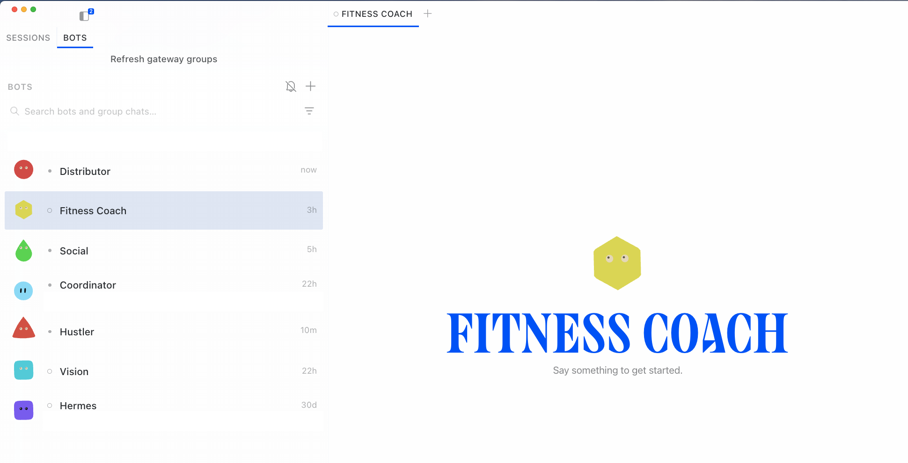
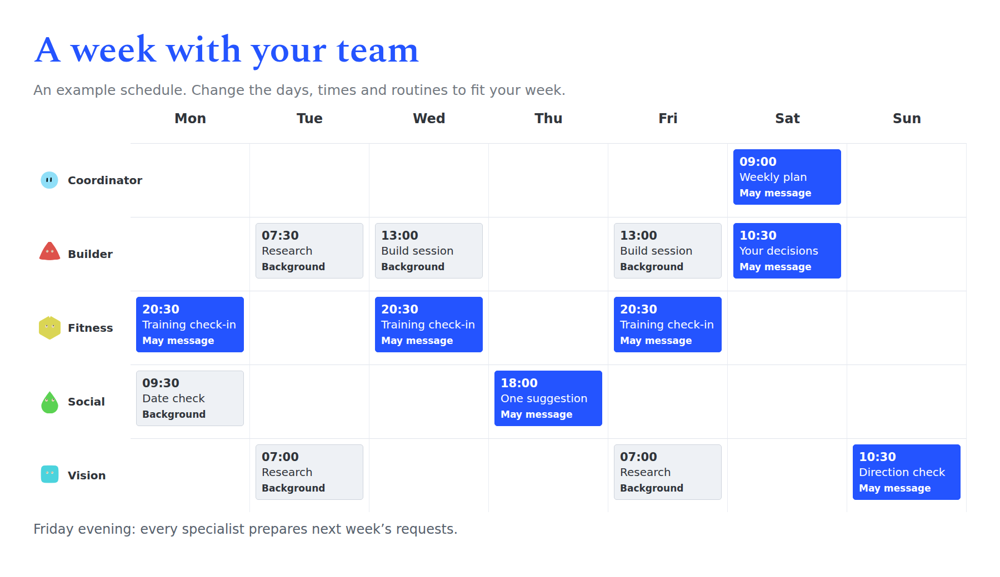
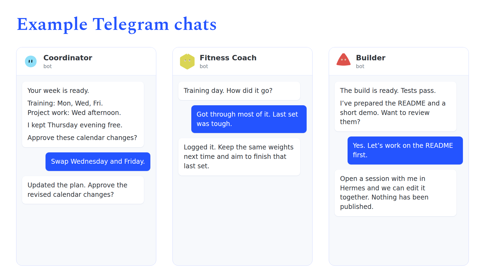

# Cornermen

**A personal AI team template for Hermes Agent.**



Cornermen is an opinionated template for [Hermes Agent](https://hermes-agent.nousresearch.com/docs) that sets up specialist profiles, a shared workspace and scheduled routines.

I built it because one general assistant kept losing track of everything I wanted to work on. Here each specialist owns one area of your life, works on it in the background, and messages you only when something needs your attention. You decide; the team does the research, planning and follow-up.

## Meet your team

Start with Coordinator, Fitness, Builder, Social and Vision. Each has its own instructions, memory and conversations. The coordinator keeps the others aligned: it owns your shared goals and priorities, settles conflicts between specialists, and turns their requests into one weekly plan.



The template also gives the team a folder structure for your goals, decisions and work history. The coordinator uses it to gather requests into one weekly plan; you can read, edit and take the files to another harness.



## Key features

- ✓ Separate assistants with their own memory
- ✓ Multiple chats per specialist, desktop and Telegram
- ✓ Scheduled tasks and hands-on sessions
- ✓ Own your accumulated context
- ✓ ChatGPT/Codex subscription support, plus Claude and other models

## Why this template?

Grok Bot, OpenClaw, Muse and ChatGPT Dots offer other ways to use personal agents. Cornermen brings the combination I wanted into Hermes: separate specialists, hands-on work, model choice and context I own.

| Capability | Cornermen + Hermes | Grok Bot | OpenClaw | Muse | ChatGPT Dots |
|---|:---:|:---:|:---:|:---:|:---:|
| Separate specialists | ✓ | ✓ | ◐ | ? | ✕ |
| Multiple chats per specialist | ✓ | ✓ | ✓ | ? | ◐ |
| Scheduled and direct work | ✓ | ✓ | ✓ | ✓ | ✓ |
| Desktop workspace | ✓ | ✓ | ✓ | ✓ | ✓ |
| Choose model / provider | ✓ | ✕ | ✓ | ? | ? |
| ChatGPT/Codex subscription | ✓ | ? | ✓ | ? | ? |
| Editable context files | ✓ | ? | ✓ | ? | ? |
| Personal-team template | ✓ | ◐ | ◐ | ? | ? |

✓ Supported · ◐ Setup or limits · ✕ Unavailable · ? Not verified. [Details and sources](docs/comparison.md).

## Work with your team in Hermes

Open a specialist and start a conversation for the task at hand. Keep separate sessions for different projects and return to them later. This is where you work with the team hands-on: research a project with Builder, plan a training block with Fitness, or rethink your direction with Vision.



## A week with Cornermen

Specialists run their own routines and prepare requests for the coordinator’s weekly plan. Change the schedule to fit your week; calendar changes wait for your approval. Most scheduled runs stay silent: each specialist has a small weekly message budget, so you hear from it only when it has something worth your time.



## On Telegram

Message each specialist through its own bot. Send your coach a workout update or review a proposal from the coordinator without opening your computer.



## Set it up

**Recommended: run the team on an always-on remote server.** Use the Hermes desktop app on your laptop and Telegram on your phone. The workspace and scheduled routines stay on the server, so your laptop can be off.

On the server, install [Hermes Agent](https://hermes-agent.nousresearch.com/docs/getting-started/installation), configure a model, and install Cornermen below. You need Python 3.9+ and a separate Telegram bot for each specialist you want to message.

```bash
git clone https://github.com/tangent-hq/cornermen.git
cd cornermen
python3 scripts/install.py --timezone Europe/Amsterdam --dry-run
python3 scripts/install.py --timezone Europe/Amsterdam
```

Use your timezone. Add `--team minimal` for coordinator and fitness. If Hermes profiles with these names already exist, the installer stops instead of overwriting them.

Start the desktop backend on the server:

```bash
hermes serve
```

Install [Hermes Desktop](https://hermes-agent.nousresearch.com/docs/user-guide/desktop) on your laptop, then add the server in **Settings → Gateways**. Use an SSH connection to keep the backend private; do not expose its port to the public internet. See [remote connections](https://hermes-agent.nousresearch.com/docs/user-guide/multi-connection-desktop).

1. Connect each Telegram bot in Hermes on the server.
2. Run `hermes gateway restart`, then `python3 scripts/doctor.py`.
3. Tell the coordinator about your goals and week.
4. Activate the routines when your context is ready:

```bash
python3 scripts/activate.py
```

[Full setup](docs/how-it-works.md) · [Model connections](https://hermes-agent.nousresearch.com/docs/integrations/providers) · [Customization](docs/customizing.md)

## Change the team

```bash
python3 scripts/install.py --add distributor
python3 scripts/install.py --remove social
python3 scripts/new-agent.py finance --tagline "budget, savings, investing"
python3 scripts/install.py --add finance
```

Removing a specialist pauses its routines and keeps its files. New specialists need their own messaging bots. A specialist is just a folder in `agents/`: a persona, a short brief and a list of routines, so adding one for finance, study or a side project takes a few minutes.

## Approval and privacy

Assistants are instructed to ask before posting, spending, contacting others or changing your calendar. These are agent instructions, not a security sandbox. Model and messaging providers process what you send through them. Keep workspace backups private.

## License

MIT
